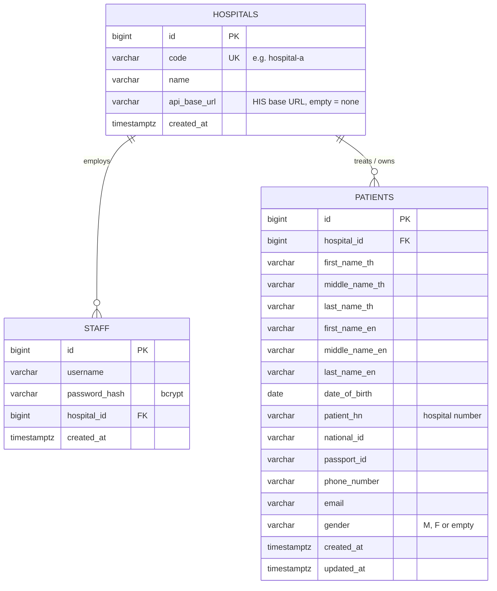

# ER Diagram

## Constraints and indexes

| Table | Constraint / index | Purpose |
|---|---|---|
| hospitals | `UNIQUE (code)` | staff APIs identify a hospital by code |
| staff | `UNIQUE (username, hospital_id)` | same username may exist in different hospitals |
| staff | `FK hospital_id → hospitals.id` | a staff member belongs to exactly one hospital |
| patients | `UNIQUE (hospital_id, patient_hn)` | HN is unique only within a hospital; target of the upsert |
| patients | `FK hospital_id → hospitals.id` | tenant boundary |
| patients | `CHECK gender IN ('M','F','')` | matches the HIS contract; `''` = HIS sent no gender |
| patients | partial index `(hospital_id, national_id) WHERE national_id <> ''` | fast id lookup |
| patients | partial index `(hospital_id, passport_id) WHERE passport_id <> ''` | fast id lookup |
| patients | index `(hospital_id, date_of_birth)` | DOB search |

## Mapping of HIS response → `patients`

The columns mirror the Hospital A response one-to-one (`first_name_th … gender`), so a HIS payload can be
stored without transformation. `hospital_id` is the only added column - it is what makes
"staff can only search patients of their own hospital" enforceable.
